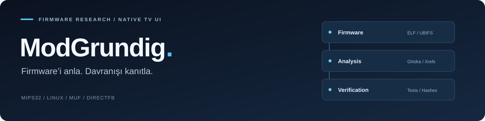
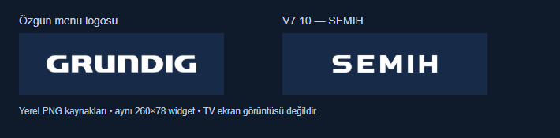

<div align="center">



**Grundig GMGRMR firmware araştırması ve native televizyon arayüzü geliştirme projesi.**

[Dokümantasyon](docs/README.md) · [Mimari ve bulgular](docs/TERSINE_MUHENDISLIK.md) · [Son aday: V7.10](docs/UI_NATIVE_V710_SEMIH_VE_HIZ.md) · [Katkıda bulun](#katkıda-bulunma)

Linux · MIPS32 · MUF / DirectFB · Python · Ghidra

</div>

## Proje hakkında

ModGrundig, **GMGRMR V03.017.04** yazılım ailesinin yapısını anlamak ve mevcut televizyon deneyimini native kod ile iyileştirmek için geliştirilen açık kaynak bir araştırma projesidir. Firmware bölümleri, ELF modülleri, servis bağlantıları, kaynak tabloları ve arayüz davranışları birlikte incelenir.

Amaç, değişiklikleri gerçek `libmuf` / DirectFB kaynaklarına bağlamak ve sonuçları dosya, fonksiyon adresi, çağrı ilişkisi ve doğrulama kayıtlarıyla belgelemektir. **Tarayıcı önizlemesi, native kod testi ve fiziksel TV gözlemi ayrı kanıt düzeyleridir.**

## Çalışma alanları

| Alan | Kapsam |
|---|---|
| **Firmware mimarisi** | Bölüm yerleşimi, dosya sistemleri, açılış zinciri ve güncelleme formatının çevrimdışı analizi. |
| **Modül ve çağrı haritaları** | 226 ELF modülünün envanteri; import/export, sembol, bağımlılık ve seçilmiş fonksiyon incelemeleri. |
| **Native UI** | Ses paneli, mute durumu, kanal numarası girişi ve menü kaynaklarında izlenebilir değişiklikler. |
| **Doğrulama araçları** | Kaynak hash kontrolleri, odaklı testler, dosya sistemi yeniden çıkarımı ve paket bütünlüğü kontrolleri. |
| **Araştırma bilgi tabanı** | Ghidra çıktıları, JSON kanıtları, sürüm notları ve açık teknik sorular. |

Envanterin tamamlanması, bütün fonksiyonların çözüldüğü veya kaynak kodun eksiksiz geri kazanıldığı anlamına gelmez. Diğer Grundig, Beko ve Arçelik modelleriyle uyumluluk ayrıca doğrulanmalıdır.

## Güncel durum

**Son belgelenen aday V7.10; fiziksel cihaz geri bildirimi bulunan temel sürüm V7.7’dir.**

| Sürüm / konu | Durum | Ayrıntı |
|---|---|---|
| **V7.10** | Çevrimdışı doğrulandı; TV testi yok | Native **SEMIH** menü logosu; V7.9 ses/kanal davranışları korunur. [Rapor →](docs/UI_NATIVE_V710_SEMIH_VE_HIZ.md) |
| **V7.9** | Çevrimdışı doğrulandı; TV testi yok | Seviyeye göre ses ikonları ve azaltılmış sol kenar boşluğu. [Rapor →](docs/UI_NATIVE_V79_SEVIYELI_SES.md) |
| **V7.7** | Kullanıcı cihaz geri bildirimi var | 27 Ekim 2026’da TV’de çalıştığı bildirildi; kapsamlı donanım testi değildir. [Rapor →](docs/UI_NATIVE_V77_PAKET.md) |
| **4K / HEVC** | Araştırma sürüyor | Doğrulanmış 4K kilit açma çözümü yoktur. [Araştırma →](docs/4K_YAYIN_VE_GIZLI_OZELLIKLER.md) |

> **Kapsam notu:** V7.10 yeni hızlı kanal geçişi veya hızlı açılış özelliği eklemez. Hızlı kanal geçişi mevcut native ayardır; hızlı açılış için güvenilir ek hızlandırma yaması çıkarılmamıştır. **V7.3, cihazda donma bildirimi nedeniyle reddedilmiştir.** Eski çalışmalar [sürüm arşivinde](docs/README.md) tutulur.

## Native kaynaklardan bir örnek



*Gerçek PNG kaynakları, aynı native widget ölçeğinde gösterilir. Bu bir TV ekran görüntüsü değildir. Yeni harfler özgün bitmap stiline yaklaştırılmıştır; birebir OEM fontu geri kazanılmamıştır.*

## Hızlı başlangıç

Kaynağı ve sabitlenmiş araç alt depolarını indirin:

```bash
git clone --recurse-submodules https://github.com/Semihkrks/ModGrundig.git
cd ModGrundig
git lfs pull
```

Son komut için **Git LFS** kurulu olmalıdır. LFS ile tutulan dosyalar `analiz/ui-kod-cagrilari.json` ve `analiz/dosya-sistemleri-tam.tar` dosyalarıdır. Eksik alt depolar için `git submodule update --init --recursive` kullanılır. REA alt depolarındaki bazı test dosyaları Windows dosya adı/uzun yol sınırlarına takılabilir; bu durumda WSL/Linux kullanın.

**İlk okuma rotası:**

1. [Sistem bilgi tabanı](docs/bilgi-tabani/README.md) — mimari ve modül rolleri.
2. [Tersine mühendislik raporu](docs/TERSINE_MUHENDISLIK.md) — kanıtlar ve tamamlanan kapsam.
3. [UI kod yapısı](docs/UI_KOD_YAPISI.md) ve [kaynak haritası](docs/UI_HARITASI.md) — native arayüz bağlantıları.
4. [Kurulum kaydı](docs/KURULUM.md) — araçlar, yerel yollar ve yeniden üretim koşulları.

Analiz ortamında Windows, Ubuntu/WSL, Python, Ghidra/JDK ve seçilmiş native testler için ek araçlar kullanılır. Scriptler henüz taşınabilir, tek komutlu kurulum sunmaz; bazıları yerel kaynaklar ve hash ile sabitlenmiş önceki çıktılar gerektirir. **Depoyu klonlamak, tek başına firmware oluşturma veya tam TV emülasyonu sağlamaz.**

## Doğrulama yaklaşımı

| Kanıt düzeyi | Ne gösterir? |
|---|---|
| **Dosya / kaynak incelemesi** | İmaj içeriği, kaynak kimlikleri ve hash ile doğrulanan girdiler. |
| **Statik kod analizi** | İncelenen fonksiyonun assembly/decompile davranışı ve kanıtlanan çağrı yolları. |
| **Host / sınırlı native test** | Testin kapsadığı bayt, durum veya fonksiyon sözleşmesi; tam TV davranışı değildir. |
| **Fiziksel cihaz gözlemi** | Yalnız bildirilen cihaz, sürüm ve denenen senaryo. |

V7.10 kayıtlarında **25/25 odaklı kontrol**, bağımsız native inceleme ve APP/BIN/RAR çevrimdışı doğrulamaları bulunur. Bunlar tüm televizyon işlevlerinin test edildiği anlamına gelmez. [Doğrulama kaydı →](analiz/native-ui-candidate/v7.10-tv/phase-results.json)

## Depo yapısı

```text
ModGrundig/
├── docs/        Mimari, araştırma raporları ve sürüm belgeleri
├── scripts/     Analiz, dönüşüm, doğrulama ve test araçları
├── analiz/      Envanterler, kanıtlar ve seçilmiş çıktılar
├── native-ui/   Native yardımcılar ve önizleme araçları
├── tools/       Araç sarmalayıcıları ve ortam notları
└── rea/         Sabit commit’e bağlı REA alt deposu
```

Güncel ELF/sembol/bağımlılık envanteri **[`analiz/envanter-v2/`](analiz/envanter-v2/)** altındadır. Eski kök JSON’lar tarihsel izlenebilirlik için korunur. `analiz/dosya-sistemleri/` ilk kısmi çıkarımdır; tamamlanmış ağaç değildir. Güncel okuma görünümü `analiz/dosya-sistemleri-tam/`, doğrulanmış imaj kayıtları `analiz/firmware-dogrulanmis/` altındadır.

Tam üretilmiş firmware paketleri, yerel araç kurulumları, orijinal devir arşivi, özel anahtarlar ve sertifika bölümü yayımlanmaz. Belgelerdeki bazı paket yolları yerel analiz çıktısına aittir; GitHub indirmesi değildir. [GitHub / yerel dosya ayrımı →](docs/GITHUB_SENKRON.md)

## Katkıda bulunma

Hata bildirirken ilgili sürümü, dosyayı veya fonksiyon adresini, beklenen davranışı ve gözlenen sonucu belirtin. Cihaz seri numarası, anahtar, sertifika veya özel hesap bilgilerini paylaşmayın.

Orijinal girdileri koruyun; scriptleri `scripts/`, kanıtları `analiz/`, açıklamaları `docs/` altında tutun. Değişikliğin kapsamına uygun testleri ve çözülemeyen noktaları ekleyin. Normal menüde kullanılabilen ayarlar, yeni veya gizli özellik olarak sunulmamalıdır.

[Sorun bildir](https://github.com/Semihkrks/ModGrundig/issues) · [Değişiklik öner](https://github.com/Semihkrks/ModGrundig/pulls)

## Lisans ve araçlar

Projenin özgün kodu ve dokümantasyonu [MIT lisansı](LICENSE) ile sunulur. Üçüncü taraf araçlar ve üreticiye ait materyaller kendi hak ve lisanslarına tabidir; bu projenin lisansı bunlara ek hak vermez.

[Reverse Engineer Anything](https://github.com/morluto/rea) sabitlenmiş alt depo olarak kullanılır. Eski MIPS ELF ABI sınırlarında doğrudan Ghidra analizi yapılır; bu çıktılar REA Evidence olarak etiketlenmez. ModGrundig bağımsız bir projedir; Grundig, Beko veya Arçelik’in resmî yazılım dağıtımı değildir.
