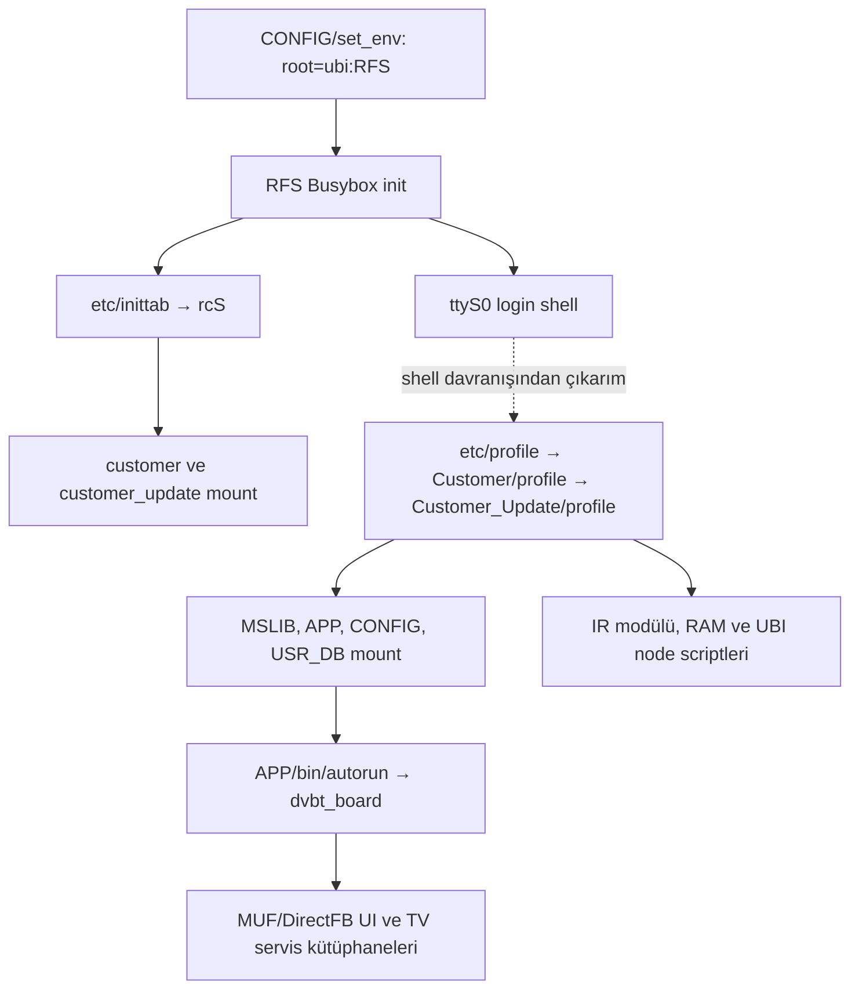

# Grundig GMGRMR V03.017.04 — tersine mühendislik

Güncel sistem aşaması ve modül bazlı durum: [bilgi tabanı](bilgi-tabani/README.md). Genişletilmiş UI aşaması: [136 odaklı giriş / 132 C çıktısı ve adresli davranışlar](UI_KOD_YAPISI.md). İlk 54/26 sorgunun sayaçları bu genişletilmiş kapsamla karıştırılmamalıdır.

22 Ekim 2026. İncelenen kaynak kullanıcının sağladığı RAR'dır; fiziksel TV'nin aktif firmware dump'ı değildir. Bu rapor dosya/format, statik kod ve cihaz gözlemini birbirinden ayırır. Cihazda gözlem yapılmadı. Yeni odaklı kod bulguları [UI bağlantı haritasında](UI_HARITASI.md): ana uygulamada 54 sorgu/48 tamamlanmış decompile, MUF'ta 26/26. Bunlar kısmi statik sonuçlardır; tam çağrı grafiği değildir.

## 1. Açılan paket ve doğrulamalar

RAR bütünlük testi 7-Zip 26.04 ile geçti. İki BIN ve diğer 15 dosya çıkarıldı:

| Kaynak | Bayt | SHA-256 |
|---|---:|---|
| Orijinal devir ZIP'i | 44.610.991 | `299cb13a2fe939c531224321952a0be196d3e19fa51441ac4e928a9e30d55f6a` |
| Firmware RAR | 42.604.212 | `dd0d297d0611f240e1336042483ee46ec73a7b9f669510f45664677f4950a46c` |
| GM_SWImage.bin | 42.483.736 | `6d7614730c5f63b9e6727b8b329606b188b581efb366bffde6991aca123852c0` |
| GM_Boot.bin | 2.288.972 | `2a4e909696163e947ceed9106b00ac5512c4c8890a253a623307acd10a7885a1` |

`GM_SWImage.bin:0x0` güncelleme tablosunu 0x4000 bayt olarak bildirir. İçindeki `filepartload`, `mscompress7`, `crc32`, NAND/UBI yazma ifadeleri veri olarak parse edildi; çalıştırılmadı.

- 14/14 sıkıştırılmış aralık LZMA-alone olarak açıldı: toplam 78.561.732 bayt.
- 14/14 beyan edilen CRC32 değeri Python `zlib.crc32` ile eşleşti.
- 8/8 UBIFS ilk superblock node type/uzunluk/CRC doğrulandı.
- Kernel uImage header ve payload CRC'leri geçti; ad `Linux-3.1.10-mstar`.
- Beş mboot açılımı GM_Boot içindeki ilgili beş aralıkla hash olarak eşleşti. Padding boşlukları bu karşılaştırmanın kapsamında değildir.
- Her LZMA aralığında iki trailing bayt bulunur; yeniden paketlemede bunların anlamı ayrıca incelenmelidir.

Kanıt: `analiz/bolum-haritasi.json`. CRC eşleşmesi kriptografik imza veya hedef TV uyumu kanıtı değildir.

## 2. Bölüm ve dosya sistemi haritası

Güncelleme tablosu fiziksel NAND düzenini `KL`, `UBIRO`, `UBI_ARCELIK`, `UBI` olarak bildirir. Bu, cihazın şu anki bölüm tablosunun dump'ı değildir.

| Payload | Bildirilen hedef | Açılmış biçim/boyut |
|---|---|---|
| 00–04 mboot | Boot aralıkları | 5 parça; GM_Boot ile kısmi aralık eşleşmesi |
| 05_KL | KL | uImage, 1.758.840 bayt |
| 06_RFS | RFS | UBIFS, 6.602.752 bayt |
| 07_MSLIB | MSLIB | UBIFS, 29.077.504 bayt |
| 08_APP | APP | UBIFS, 29.077.504 bayt |
| 09_CONFIG | CONFIG | UBIFS, 3.047.424 bayt |
| 10_customer | customer | UBIFS, 1.777.664 bayt |
| 11_customer_update | customer_update | UBIFS, 1.777.664 bayt |
| 12_certificate | certificate | UBIFS, 1.650.688 bayt; hassas içerik okunmadı |
| 13_oad | oad | UBIFS, 1.650.688 bayt; çıkarıcı `No inodes found` bildirdi, bağımsız metaveri yürüyüşü tek root inode'u buldu |

Güncelleme ayrıca USR_DB/BACKUP_DB/arubi hacimleri tanımlar; bunlara karşılık kullanıcı verisi payload'ı varmış gibi dosya uydurulmadı.

Sekiz UBIFS çıkarımı sonunda 4.065 ağaç girdisi kaydedildi: 2.952 normal dosya, 753 dizin, 360 symlink. RFS özel cihaz node'ları root yetkisi istenmediği için materialize edilmedi. Ayrı UBIFS metaveri yürüyüşü bunları da buldu: 267 block + 113 character device; toplam 4.445 inode/path kaydı. Orijinal inode izin/sahiplik/size ve device metadata'sı `analiz/ubifs-orijinal-metadata.json` içinde korunur. Normal dosya içeriği/xattr değeri bu metaveri yürüyüşünde okunmaz.

OAD indeksinde tek root directory inode'u ve sıfır dizin girdisi var. Stock çıkarıcının `len(inodes)<2` sınırı bu durumda hata metni üretir; bu gözlem tek başına boş/bozuk/tam dosya sistemi hükmü değildir. Materialize edilen ağaç tüm izin/sahiplik/xattr'ları uygulanmış, yeniden flash edilebilir bir rootfs değildir.

## 3. Açılış → uygulama

Somut dosya referansları:

- `06_RFS/etc/inittab:1`: `/etc/init.d/rcS`; `:2`: `ttyS0::respawn:-/bin/sh`.
- `06_RFS/etc/init.d/rcS:8–9`: customer_update/customer mount.
- `/etc/profile → /Customer/profile → /Customer_Update/profile` symlink zinciri canonical Linux envanterinde mevcut.
- `11_customer_update/profile:6`: `LD_LIBRARY_PATH=/mslib:/mslib/utopia:/mslib/gstreamer-0.10:/config:/mslib/directfb-1.4-0/inputdrivers/:/mslib/ginga/jvm/lib/`.
- Aynı profil `:53/56/60/63`: MSLIB/USR_DB/APP/CONFIG mount; `:77`: `mdrv-ir.ko`; `:109`: göreli `cd applications/bin`; `:115`: `./autorun signal`.
- APP `bin/autorun → dvbt_board`. Göreli cd'nin başlangıç CWD'si `/` beklentisi cihazda gözlenmedi.
- CONFIG `delaymount.sh:3/6/15`: OAD/certificate/BACKUP_DB.
- CONFIG `set_env:10–11`: UBIFS RFS root ve ttyS0/115200 bootargs kalıbı; güncel cihaz environment dump'ı değildir.

Kernel wrapper içindeki `0x13c0` LZMA akışı ayrıca açıldı: 5.306.304 bayt; SHA-256 `43e9cf9a68cefafb14beb936cd37f801a69412b69cfc127bd7c866fe431c3426`. Kernel içindeki init aday string'leri tek başına gerçek boot seçimi kanıtı değildir.

## 4. Uygulamalar ve kütüphaneler

226 ELF'in tamamı ELF32/little-endian/MIPS: 16 EXEC, 200 DYN, 10 REL. Tüm ELF'lerde readelf başarıyla çalıştı ve sembol/relocation tablo sayımları tamamlandı.

Ana uygulama `08_APP/bin/dvbt_board`: 13.836.676 bayt; SHA-256 `51f6bd24ea6f1a152aa7142e2b993dcd615d01840a7127a3cc2484fe29748916`. Dynamic symbol sayısı 8.919; güncel v2 envanterde **1.712 import, 7.203 export**, 13.624 relocation. Önceki sayımda 36 MIPS PLT import'u export sayılmıştı; readelf annotation parser'ı düzeltildi. Eski JSON'lar önceki sorguların provenance kaydıdır; güncel envanter `analiz/envanter-v2/` altındadır.

1.523 DT_NEEDED bağımlılık kaydı çıkarıldı. 1.521'inde dosya/SONAME adayı var; çalışma zamanı bağlanması doğrulanmadı. `mkdfiff` ve `mkdgiff` için `libdirect-1.2.so.0` adayı bulunamadı. Bu iki aracın eksik bağımlılığı ana TV uygulamasının çalışmayacağını kanıtlamaz.

226 modülün dynamic sembolleri v2 envanterle yeniden eşleştirildi: 26.735 import satırından 19.152'sine, yalnız DT_NEEDED aday closure içinde 20.085 export bağlanma adayı bulundu. 7.583 import eşleşmesizdir; bu, runtime eksikliği hükmü değildir. `dvbt_board` için 1.710/1.712 import aday eşleşmelidir; eşleşmeyen iki sembol `_Jv_RegisterClasses` ve `__gmon_start__`.

Somut aday uçlar: `dvbt_board → libmsrv_common.so: MSrv_SSSound::SetVolume`; `dvbt_board → libmuf.so: MSystem::GetMResourceManager`; `libMStarSDK.so → libapiAUDIO.so: MApi_AUDIO_SetMixModeVolume`; SDK → libapiCEC: `MApi_CEC_SetPowerState`; SDK → libdrvIR: `MDrv_IR_Config/Init`. `dvbt_board → libar_cec.so` için DT_NEEDED var, doğrudan import/export eşleşmesi sıfırdır. Bu farklı kanıt türleri `sembol-baglantilari.json` içinde ayrı tutulur.

İnceleme odağı: `libmuf` UI/event sistemi; `libdirectfb` render altyapısı; `libar_cec` CEC katmanı; `libmsrv_*` TV servisleri; `libMStarSDK*`, `libapiCEC`, `libapiAUDIO`, `libdrvIR` donanım API'leri. Bunların işlevleri isim/simge ve bağımlılık kanıtıyla sınıflandırılır; tek başına isim gerçek çağrı kenarı değildir.

## 5. Tema ve kaynak tabloları

APP kök `rc/ResProfile` varsayılan olarak `rc` profilini belirtir. `rc/rc`, `rc/rc_Beko`, `rc/rc_Arcelik` ayrı Image/Color tablolarına bağlanır. Dil profilleri ve 1920×1080 kaynak çözünürlüğü tanımı vardır. CONFIG DirectFB yapılandırmasında ayrıca 1280×720/ARGB4444 tanımları vardır; kaynak tasarım çözünürlüğü ile aktif render yüzeyi aynı varsayılmamalıdır.

Üç `Image_res.bin` tablosunun her biri 2.179 kayıt olarak tam parse edildi: 56 bayt header, sonra uint32_le uzunluk + NUL sonlandırılmış path. Toplam 6.537 kayıt ofset/indeks/hash ile kaydedildi. Her tabloda 1.169 yol çıkarılmış normal dosyaya çözülüyor, 1.010 yol için dosya bulunmadı; bunlar eksik/legacy/başka build kaynağı olasılıklarıyla açık bırakıldı. İndeksin uygulama resource ID'sine dönüşümü kodla doğrulanmadan ikisi eşit sayılmaz.

Devir paketindeki 20 asıl PNG'nin tamamı firmware içinde SHA-256 ile eşleşti. Altı mavi adayın adları gerçek eşleriyle aynı değil:

| Devir dosyası | Birebir gerçek firmware eşi (`rc/ARimages/`) |
|---|---|
| bg_bar.png | Grundig/PopUp/title.png; Grundig/new/popup/title.png |
| bg_bar_focused.png | Grundig/PopUp/arrow.png; Grundig/new/popup/arrow.png |
| volume_ellipse.png | Grundig/volume/volume_icon.png |
| bg_top_bar_intersection.png | Grundig/half/homeScreen/bg/bg_top_bar.png |
| level2.blue.bg.active.png | Grundig/half/homeScreen/bg/level3.blue.bg.png |
| level3.blue.bg.png | Grundig/half/homeScreen/bg/level3.blue.bg.active.png |

Diğer 14 PNG `Common/popups/volumeControl/` altında aynı adla eşleşir. Bu 14 kaynak üç marka tablosunda da bulunur. TV'deki mavi ses panelini bunlardan hangisinin çizdiği, yalnız isim/hash ile belirlenemez.

## 6. Kumanda ve CEC

CONFIG içinde altı `mufirkeymap*` tablosu: toplam 324 aktif eşleme satırı. HW keycode → MUF key ID → etiket kaydedildi. Hangi haritanın cihazda seçildiği bilinmiyor.

| İşlev | HW → MUF |
|---|---|
| Ses + | 0x10 → 0xf04c |
| Ses − | 0x11 → 0xf04d |
| Mute | 0x0d → 0xf04e |
| Menü | 0x19 → 0xf012 |
| CEC (TP6) | 0x1b → 0xf589 |

Bu altı tabloda doğrudan MVK_HOME kaydı bulunmadı. HOME davranışı var/yok sonucu için UI dispatcher ve seçili kumanda profili çözülmelidir.

CONFIG `Flags`: CEC_ENABLE=1, ARC_ENABLE=1, USE_ARCHITECT_LAYER=1 ve USE_ARCHITECT_UI_LAYER=1. Dil tablolarında HDMI CEC/DIGILINK metinleri var. Bunlar paket içeriği/derleme seçeneği kanıtı; cihazın mevcut CEC ayarı değildir.

Tanımlı ELF simgeleri sonraki kod referanslarını sabitler: `SetBrandOSDAndBootLogo=0x61c3a0`, `SetBrandOSD=0x61cb5c`, `GetOSDBrandName=0x6253dc`, `SetRemoteControl=0x6198dc`, `CecSettingsFrame::OnKey=0x884a9c`. Statik decompiler sonuçları native çıktı dizininde ayrı tutulur.

## 7. Sınırlar ve açık uçlar

- Sağlanan RAR'ın 40 CLE 5745 AN anakart/paneliyle eşleşmesi kanıtlanmadı.
- OAD root-only indeks gözlemi var; özel node ve izinler metaveri olarak korundu, hostta uygulanmadı; xattr içerikleri incelenmedi.
- Tema ve kumanda profili seçimini etkileyen kalıcı cihaz ayarları/runtime gözlemi yok.
- Binwalk imza çıktısı üretilmedi; paket formatı doğrudan header/LZMA/CRC ile incelendi.
- Aktif ses OSD kaynak-ID/widget ilişkisi kod xref'leriyle incelenir; hash eşleşmesi aktif kullanım kanıtı değildir.
- İndirect call, C++ vtable/event kayıtları ve runtime dinamik yüklemeler çözülemeyen kenarlar bırakabilir.
- Sertifika/anahtar/benzersiz cihaz kimliği adayları içerik incelemesinden hariç tutuldu.
- Repack/flash kabulü, kriptografik imza, recovery ve cihazda çalışma bu araştırmayla doğrulanmış sayılmaz.

Yeni özellik veya tasarım değişikliği yapılmadı. Sonraki görevler bu haritalardaki gerçek dosya/simge/ofsetlere bağlanabilir.
