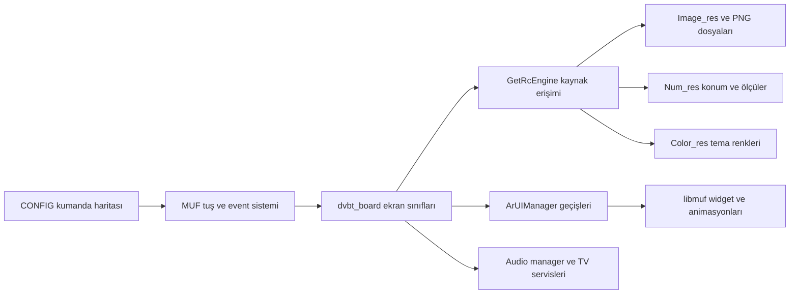

# UI bağlantı haritası

23 Ekim güncellemesi: [dört büyük UI gövdesinin C çıktıları ve kalan belirsizlikler](bilgi-tabani/UI_DORT_BUYUK_FONKSIYON.md). Settings sınırlanmış çıkarım kullanır; eski dört timeout listesi güncel C yokluğu anlamına gelmez.

Sonraki genişletilmiş aşama: [UI kod yapısı](UI_KOD_YAPISI.md). Orada timer birimi ms olarak doğrulandı; ID→indeks yolu, focus slotu ve seçili animasyon gate'leri çözüldü. Aşağıdaki 54/26 sayaçları ilk odaklı sorgunun kapsamıdır.

22 Ekim 2026. Sağlanan GMGRMR V03.017.04 paketi çevrimdışı incelendi. Menü, ses animasyonu veya firmwarAe değiştirilmedi; TV'de çalıştırma yapılmadı. Bu belge sonraki UI görevlerinin başlangıç noktasıdır.

## Arayüzü hangi katman yönetiyor?

Bu şema incelenen statik ilişkileri özetler; tam çağrı grafiği veya cihazda gözlenen akış değildir. Ana uygulama `08_APP/bin/dvbt_board`, UI kütüphanesi `07_MSLIB/libmuf.so` olarak envanterlenmiştir; gerçek kütüphane dosya yolu için `analiz/elf-envanteri.json` kaydı esas alınır.

## Ekranların kod girişleri

Message-map kayıtlarında event `1` widget kuran callback'e, `0x14` tuş handler'ına bağlanır. Event `1` için “kurulum” yorumu callback gövdesine dayanır; enum tanımı ayrıca doğrulanmadı. Adresler `dvbt_board` sanal adresleridir.

| Ekran | Message map | Kurulum callback'i | Tuş handler'ı |
|---|---|---|---|
| Home | `0x10be5dc` | `0xd42150` | `0xd3eb34` |
| General settings | `0x10be074` | `0xd01710` | `0xcff0b0` |
| Input source | `0x10bf844` | `0xd9e300` | `0xd9da68` |
| Picture | `0x10c0d3c` | `0xe28b14` | `0xe26d08` |
| Quick settings | `0x10c1c34` | `0xea4118` | `0xea38fc` |
| Sound | `0x10c253c` | `0xee9afc` | `0xee8398` |
| Source setup | `0x10c2954` | `0xf0dd24` | `0xf0b564` |
| Tools | `0x10c34cc` | `0xf60a64` | `0xf86234` |
| Volume | `0x10c3a7c` | `0xfb9780` | `0xfb8c7c` |

RTTI kayıtları bu ekranları `CommonFrame → MMainFrame` hiyerarşisine bağlar. Kalıtım, ekranlar arasında gezinme kenarı sayılmaz. Home, General, Source setup ve Tools kurulumlarının pseudocode'u zaman aşımına uğradı; bu dört kayıt için instruction/xref verisi var, tamamlanmış C çözümü yok.

## Marka ve kaynak seçimi

`SetBrandOSD (0x61cb5c)` ve `SetBrandOSDAndBootLogo (0x61c3a0)` dalları: `1 → rc_Beko`, `2 → rc_Arcelik`, `3/4 → rc_Beko`, default → `rc`. Altus/OEM dallarının Beko kaynak yolu kullanması statik kod sonucudur. `GetOSDBrandName (0x6253dc)` kalıcı ayar servisine bağlanır; fiziksel TV'de seçilen değer bilinmiyor.

Üç marka için ayrı Image/Color tabloları, ortak Num tablosu var. Yedi scalar tabloda **30.386 u32 kayıt** kaynak hash'i, boyut ve ofsetleriyle çözüldü. Ayrıntı: `analiz/ui-deger-tablolari.json`. Image path tabloları: `analiz/ui-kaynak-haritasi.json`. Ham packed renk değerlerini dosyadaki bayt sırasından bağımsız bir renk biçimi diye yorumlamamak gerekir.

## Ses panelinin somut parçaları

Kanıt: `analiz/native/ui-targeted/dvbt_board/00fb9780.c` kurulum ve `00fb7d18.c` yenileme. Aşağıdaki ölçüler kaynakların mantıksal koordinatlarıdır; aktif TV panelindeki piksel boyutu değildir.

| Parça | Yerel rect `(x,y,w,h)` | Kaynak kullanımı |
|---|---|---|
| Normal panel | `(0,20,100,420)` | image `0x2a2`, color `0x5e` |
| Ses/mute ikonu | `(0,320,100,100)` | normal `0x2aa`, mute `0x2a8` |
| Ses rakamı | `(0,20,100,55)` | color `0x25`, size Num `0x3215 = 36` |
| Bar alanı | `(45,88,10,200)` | color `0x5e` |
| ProgressBar | parent içinde `(0,0,10,200)` | arka plan `0x24`, dolgu `0x25` |
| Hareket eden ellipse | `(37,y,25,25)` | image `0x2a9` |
| ARC ikon alanı | `(0,0,158,89)` | image `4/5/6` |

Ellipse için yenileme kodu ve mevcut Num değerleri birlikte **`y = 278 − 2 × volume`** verir: seviye 0/50/100 için y=278/178/78. Kod konumu doğrudan günceller; buradan yumuşak tween/fade sonucu çıkarılmaz.

Color `0x25`: Grundig `0xff0082d4`, Beko `0xff6372ff`, Arcelik `0xfff14242`; rakam ve bar aynı ID'yi kullanır. Bu paylaşılan tema kaynağını değiştirmek başka ekranları da etkileyebilir. `0x24 = 0xffacacac`, `0x5e = 0xfff5f5f5` üç profilde aynı.

Image tablosunda `0x2a2 → Common/popups/volumeControl/bg.png`, `0x2a8 → Grundig/volume/mute_icon.png`, `0x2a9 → Grundig/volume/volume_ellipse.png`, `0x2aa → Grundig/volume/volume_icon.png` adayları bulunur. Public ID'nin indeks dönüşümü kaynak erişim koduyla birlikte değerlendirilmelidir; cihazdaki aktif kullanım ayrıca gözlenmedi. Kurulumdaki `0x5cd` kaynağı görünüm olarak henüz adlandırılmadı.

Devir paketindeki **volume_ellipse.png**, hash olarak firmware'in **volume_icon.png** dosyasına eşittir. Gelecekte dosya değiştirirken devirde verilen ada tek başına güvenilmemelidir.

## Tuş, ses ve kapanış davranışı

`HW 0x10/0x11/0x0d → MUF 0xf04c/0xf04d/0xf04e → VolumeControlApp::Summon (0x8d1438) → event 0x14 → VolumeControlFrame::OnKey (0xfb8c7c)` zinciri statik kayıt ve kodla desteklenir. Ardından yerel ses için `ArAudioManager::MainVolumeUp/Down` veya mute yolu çalışır. Hotel/headphone koşulları davranışı ayrıca değiştirir.

Refresh içindeki modlar: `0` normal ses, `1` yerel mute, `2` ARC ses, `3` ARC mute. ARC active + CEC initialized + HDMI plugged dalı ses tuşunu CEC yoluna yöneltip yerel ses çağrısından döner. Ses seviyesinin her zaman TV hoparlörünü değiştireceği varsayılamaz.

23 Ekim düzeltmesi: `IsRcKeyProcessedByCec` ret kolu da `0xfb91ac..0xfb91d4` üzerinden Refresh ve çıkış yapar; yerel çağrıya düşmez. Yerel yol `0xfb91e0` sonrasında, ARC kapıları false iken başlar. Host model bu adresli bulguya göre düzeltildi. [Gerçek firmware adayı ve patch sınırları](UI_NATIVE_ADAY_V2.md).

Normal ve ARC ses gösterimlerinde `SetTimer(...,3000,0,1)` var. Sonraki `MTimerManager::AddTimer (0x2e24c034)` incelemesi birimi ms olarak kanıtladı: **3 saniyelik kapanış zamanlayıcısıdır**. Timer handler `0xfb7aec` uygulamayı kapatır; yerel mute açıksa ayrı `MuteControlApp` gösterilebilir.

CEC yönlendirmesindeki dönüş değerine “tuş işlendi” anlamı verilmemelidir. `0x555350` wrapper'ı ve customer `0x2df7d2f8` yolunda callback sonucu destructor/delete üzerinden korunmaz; decompiler parametre de düşürebilir. [Assembly ile kontrol edilen servis bulguları](bilgi-tabani/SERVIS_DERINLESTIRME.md).

## Menü ve ses animasyonları

`ArUIManager::ShowWithSwipe (0x57b07c)` ve `CloseWithSwipe (0x57ac08)` hem translate hem alpha nesneleri kurar. Açılış alpha `0 → 255`, kapanış `255 → 0`; süre çağıranın parametresinden gelir. Yön `0` açılışta doğrudan Show, yön `1` translate olmadan alpha kullanır. Bu kodun varlığı bütün ekranların onu kullandığını kanıtlamaz.

Bu build'de `GetAnimationEnabled (0x555ed4)` doğrudan `0` döndürür. Çağıranların kontrolü olmadan “tüm animasyonlar kapalı” sonucu çıkarılmaz. MUF `MAnimation::SetDuration (0x2e22bae8)` girdiyi `(duration / 50) × 50` olarak saklar. Sonraki timer/animation incelemesi 50 ms tick'i bağladı; [güncel UI kod yapısı](UI_KOD_YAPISI.md).

Ses handler'ında `isAnimationDone/keyCount` kapısı ve event `0x16` tamamlanma callback'i vardır. Bu, geçiş koordinasyonunu gösterir; aktif ses tween'i veya gerçek cihazdaki animasyon akıcılığı henüz doğrulanmadı.

## Kanıt kapsamı ve sonraki görev

Odaklı, read-only Ghidra sorgusu ana uygulamada **54/54 fonksiyon, 48 tamamlanmış decompile**; MUF'ta **26/26 tamamlanmış decompile** üretti. Ana uygulamada `0x55b6c0`, `0xd01710`, `0xd29500`, `0xd42150`, `0xf0dd24`, `0xf60a64` 30 saniyede zaman aşımına uğradı. “Tamamlanmış decompile” doğruluk garantisi değildir; özellikle abort sonrası akış, dolaylı çağrı ve prototip yorumlarında hatalar kalabilir.

Çıktılar `analiz/native/ui-targeted/` altında. MIPS PIC için `t9=entry` geçici analiz varsayımı kullanıldı; program veritabanına kaydedilmedi. Doğrudan Ghidra çıktıları **REA Evidence değildir**. REA'nın eski ELF ABI ret kaydı önceki raporda korunur. Yeni exporter'da doğrudan CALL adresi ile CALLIND pointer çözümü ayrıldı; bağımsız inceleme önceki hatanın giderildiğini doğruladı.

Kaynak bütünlüğü kontrolünde dört orijinal hash, 14 payload, 2.936 normal dosya ve 2.251 PNG chunk CRC kontrolü geçti; 16 hassas aday içerik kontrolünden hariç tutuldu. Scalar tablolardaki 30.386 kayıt ayrıca bağımsız karşılaştırıldı. Cihazda çalışma, aktif tema, güvenli repack/flash ve fiziksel model uyumu doğrulanmadı.

Sonraki UI görevi seçilen ekranın bu haritadaki callback ve kaynaklarına bağlanabilir: görsel şekil için PNG/Image, renk için Color, geometri için Num ve widget kodu, davranış/geçiş için event ve animasyon çağıranları. Bu aşamada değişiklik uygulanmadı.
